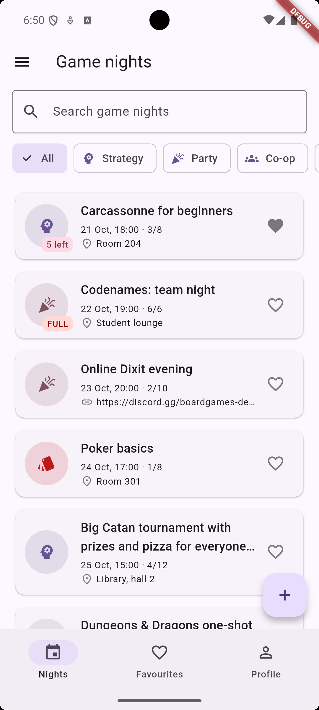
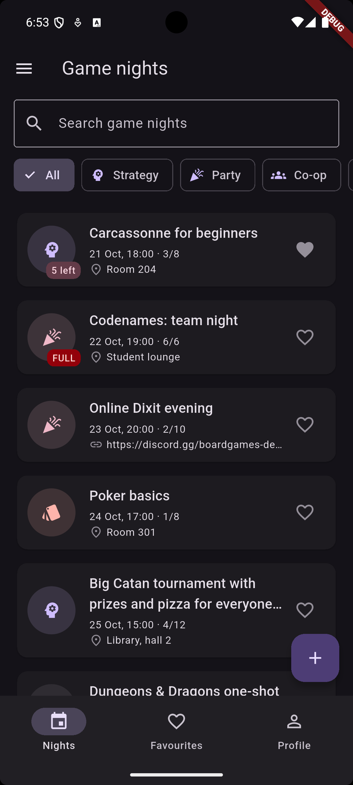
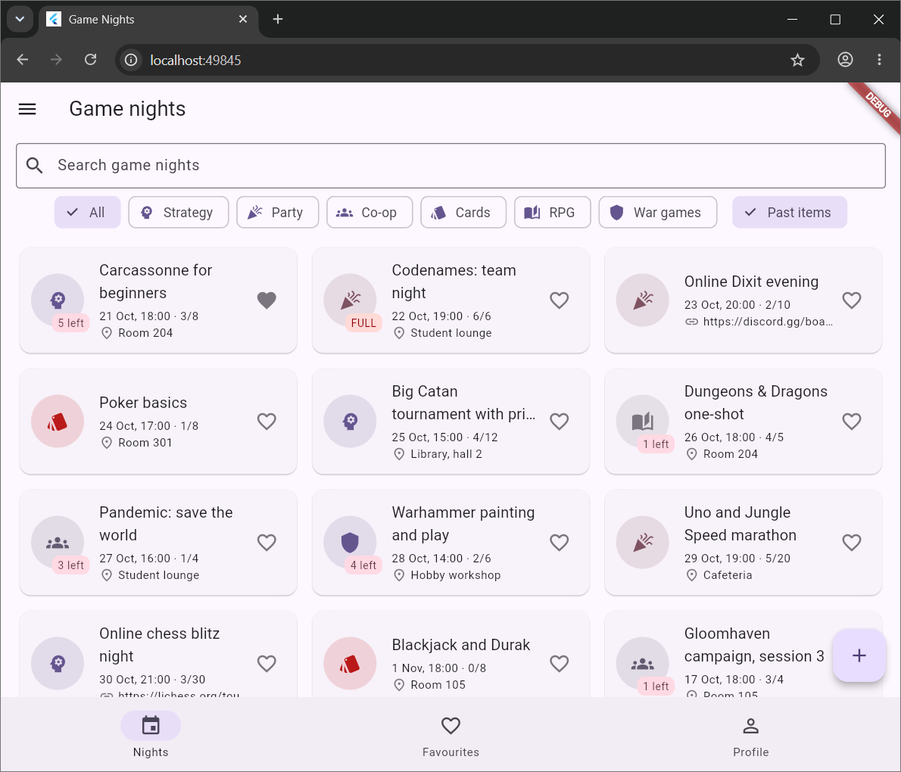

# lab01
# game nights

a flutter app for a board game club. there is a list of game nights with a category, a start time and a limit of seats. you can search and filter nights, join one, create and edit nights, and keep favourites. all data lives in memory.

## screens

- list: search, category chips, past filter, list on phones and grid on wide screens
- detail: header with countdown, about and names tabs, join and leave
- form: one screen for new and edit, with validation
- favourites and profile tabs, drawer with about and reset data

## screenshots

| phone, light | phone, dark | tablet, grid |
| --- | --- | --- |
|  |  |  |

## decisions

the list and the profile live in the shell's state, and tabs get them as parameters and send changes up with callbacks. the detail gets the item and callbacks through route arguments, because it changes data that belongs to the shell. it keeps a local copy of the item only to redraw right after joining, and the shell stays the source of truth. the form returns the edited item through pop, so the caller decides what to do with it and backing out changes nothing. the grid is a layoutbuilder because it sees the width of the list area, not of the whole window. popscope compares current values with the ones the form opened with, so a field changed back leaves the form clean. in week 9 i learned about provider and changenotifier, and i would move the list and the profile into a changenotifier, so the detail and the form read it with context.watch and change it with context.read instead of getting callbacks through route arguments.
